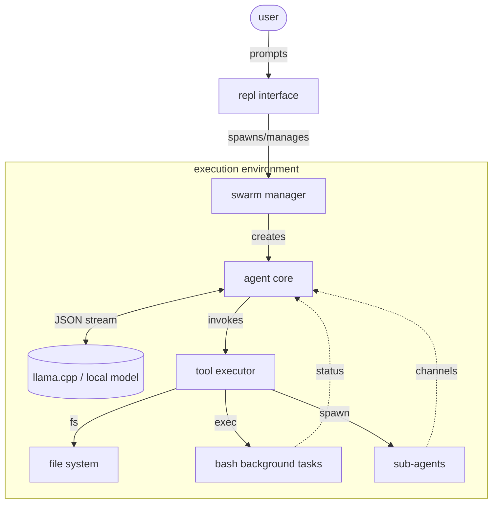
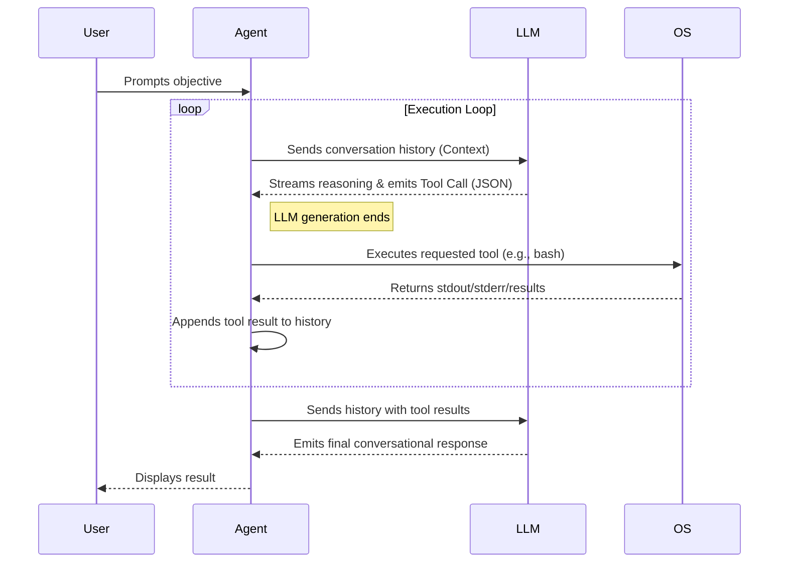

# loop

a minimalist, zero-bloat terminal harness for autonomous agents.
built in go. highly optimized for local models via llama.cpp.

no heavy frameworks. no visual noise. just raw execution.

---

### ARCHITECTURE

loop operates on a continuous feedback loop. you type a prompt. the agent reasons, spawns tasks, executes commands on your local machine, reads files, and iterates until the objective is complete.



### DEPENDENCIES

less dependencies, smaller attack surface. 

```go
module loop

go 1.26.1

require (
	github.com/alecthomas/chroma/v3 v3.0.0-alpha.5
	github.com/santhosh-tekuri/jsonschema/v6 v6.0.3
	github.com/spf13/cobra v1.10.2
	golang.org/x/sys v0.49.0
	golang.org/x/term v0.47.0
	gopkg.in/yaml.v3 v3.0.1
)

require (
	github.com/dlclark/regexp2/v2 v2.2.2 // indirect
	github.com/inconshreveable/mousetrap v1.1.0 // indirect
	github.com/spf13/pflag v1.0.9 // indirect
	golang.org/x/text v0.43.0 // indirect
)
```

### INSTALLATION

requires Go 1.26.1 or newer (the version declared in `go.mod`).

```bash
go mod tidy
go build -o loop
```

---

### USAGE

start a standard interactive session:
```bash
./loop
```

start a session with a direct objective:
```bash
./loop "audit the network layer and patch vulnerabilities"
```

Shell execution is not sandboxed. Workspace file-tool checks do not restrict shell commands, plugins, or child processes. Run untrusted work in an isolated environment.

Debug execution traces are disabled by default because they may include prompts and tool arguments. Set `LOOP_DEBUG_FILE=/private/path/loop.log` or `debug_log_file` to opt in. Newly written trace, config, and session files are private. Review older files when upgrading.

bypass interactive tool approval prompts (use with caution):
```bash
./loop --yes
```

#### nonstop mode

Run `/nostop` (alias `/loop`) to choose Eco, Balanced, or Continuous, then enter the pause in seconds. The mode cannot start without an explicit interval, including an explicit zero for Continuous. Settings are saved for future sessions. `/nostop status` shows the current choice; `/nostop off` disables it.

| Mode | Pause cadence | Interval |
| --- | --- | --- |
| Eco | Between tool turns; local tools run sequentially | At least 1 second |
| Balanced | Every five tool turns; retains configured tool parallelism | At least 1 second |
| Continuous | Between tool turns; 0 means no pause; retains configured tool parallelism | 0 seconds or more |

```text
/nostop eco 30
/nostop balanced 5
/nostop continuous 0
```

For a single launch, both flags are required when enabling the mode:

```bash
./loop --nostop eco --nostop-interval 30 "continue the implementation"
./loop --nostop continuous --nostop-interval 0 "finish the current objective"
./loop --nostop off
```

Nonstop works on the objective in your prompt until the model gives a nonempty final reply without tool calls, then returns control. A completed summary ends the run immediately, with no extra inference or pacing pause. It does not expand the goal to unrelated work. The selected mode remains enabled for your next prompt.

Empty responses, reasoning-only output, interrupted streams, and transient connection/server failures retry automatically. Failed requests back off for up to 60 seconds, or the chosen interval if longer. Nonstop removes Loop's main reasoning-step ceiling and inference inactivity timeout; history still compacts automatically. Permanent errors, tool approvals, and repetition guards remain authoritative. Ctrl+C cancels inference, tools, or a pacing pause. Prompts typed during a run steer its next turn; cancel first to run slash commands. Provider/proxy deadlines can interrupt requests and are retried when classified as transient.

#### session management

sessions are persistent. state is automatically written to disk.

```bash
./loop session list
./loop session new
./loop --resume
./loop --session <uuid>
./loop session clear
```

#### configuration

by default, configuration is stored in `~/.loop/config.json`.
the harness is heavily optimized for `llama.cpp`. Each model request still includes conversation history. For endpoints that explicitly support message `cache_control` metadata, set `"prompt_cache_breakpoints": true` in the config to opt in. Leave it off for servers that do not support that field. This cannot guarantee faster prompt processing, which depends on the provider.

```bash
./llama-server -m models/your-model.gguf -c 4096 --port 8080
```

override configuration variables on the fly:
```bash
./loop --endpoint http://localhost:8080/v1 --model local-model --thinking
```

#### tool permissions & controls

enable or disable any tool via CLI flag, config file, or dynamically in the REPL:

```bash
# disable specific tools at startup
./loop --disable-tools bash,ask_user

# or restrict execution strictly to an allowlist
./loop --tools read,write,grep
```

in the REPL:
- `/tools`: interactive toggle menu (or full catalog)
- `/tools list`: print tool list with enabled/disabled status
- `/tools disable <name...>`: disable specified tool(s)
- `/tools enable <name...>`: enable specified tool(s) (or `/tools enable all`)
- `/tools toggle <name>`: toggle tool between enabled and disabled
- `/tools reset`: re-enable all tools

in `~/.loop/config.json`:
```json
{
  "disabled_tools": ["bash", "ask_user"]
}
```

---

### AGENT CAPABILITIES

loop equips the LLM with direct access to your local machine.

- `bash`: run commands, compile binaries, start servers.
- `background tasks`: run long-running tasks asynchronously without blocking the main event loop.
- `file ops`: read files, search codebase (grep), overwrite, and surgical line-by-line replacements.
- `subagents`: spawn child agents to delegate sub-tasks.
- `memory`: load custom operational protocols (`~/.loop/LOOP.md`) and project-specific state (`MEMORY.md`).



---

### PLUGINS & EXTENSIONS

loop is extensible at runtime without recompiling the core binary.

#### tools
drop any executable script into `~/.loop/plugins/` or `<workspace>/plugins/`.
if called with `--info`, it must return a JSON schema describing its parameters. if called normally via stdin, it executes the operation. the agent instantly gains this capability.

#### slash commands
drop any executable script into `~/.loop/extensions/`.
when you type `/your-script` in the REPL, the script executes. loop pipes the entire conversation history into its `stdin` for custom telemetry, analytics, or state injection.

---

### DISCLAIMER

loop executes commands directly on your local system. running an uncensored or unpredictable model with `--yes` (auto-approve) can destroy your file system. 

use a sandbox. use source control. you have been warned.

license: MIT

author: Lucian BLETAN
