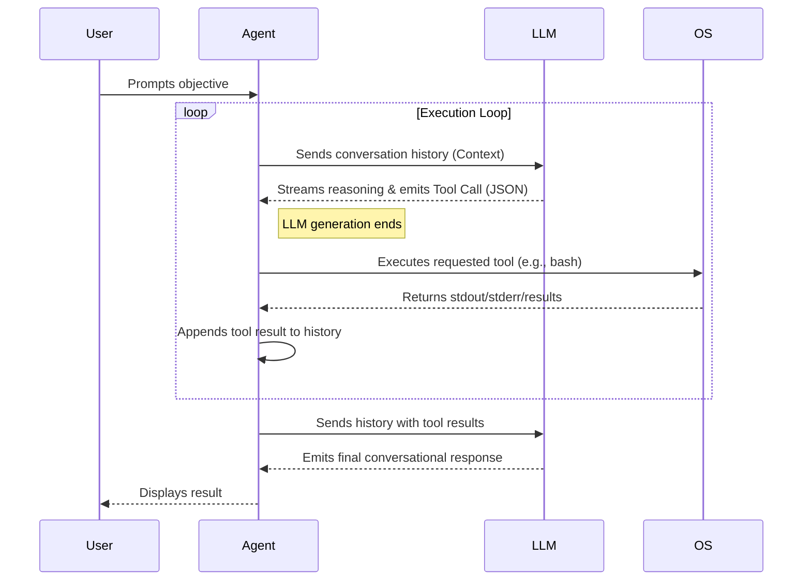

# loop

a minimalist, zero-bloat terminal harness for autonomous agents.
built in go. highly optimized for local models via llama.cpp.

no heavy frameworks. no visual noise. just raw execution.

---

### ARCHITECTURE

The execution core is designed for a shared local model endpoint. Main agents, subagents, and compaction queue inference against that endpoint; tools can run while the model is free to serve another agent. No remote scheduler, cloud service, or additional model endpoint is required. See [offline execution architecture](docs/offline-execution.md).

During a task, explicit user instructions and steering updates are retained verbatim through request trimming and compaction. The latest tool evidence remains paired with its calls; if that required context cannot fit, Loop reports the context limit instead of silently dropping instructions. Repetition protection compares observed results, including alternating calls, while allowing new file pages and background-status polling. Common file/edit failures include targeted recovery guidance, and empty searches suggest how to refine the query. These mechanisms use the existing local endpoint without extra reasoning requests. Compaction headroom scales to smaller local context windows.

loop operates on a continuous feedback loop. you type a prompt. the agent reasons, spawns tasks, executes commands on your local machine, reads files, and iterates until the objective is complete.


### DEPENDENCIES

less dependencies, smaller attack surface. 

```go
module loop

go 1.26.1

require (
	github.com/alecthomas/chroma/v3 v3.0.0-alpha.5
	github.com/santhosh-tekuri/jsonschema/v6 v6.0.3
	github.com/spf13/cobra v1.10.2
	golang.org/x/sys v0.49.0
	golang.org/x/term v0.47.0
	golang.org/x/text v0.43.0
	gopkg.in/yaml.v3 v3.0.1
)

require (
	github.com/dlclark/regexp2/v2 v2.2.2 // indirect
	github.com/inconshreveable/mousetrap v1.1.0 // indirect
	github.com/spf13/pflag v1.0.9 // indirect
)
```

### INSTALLATION

requires Go 1.26.1 or newer (the version declared in `go.mod`).

```bash
go mod tidy
go build -o loop
```

---

### USAGE

start a standard interactive session:
```bash
./loop
```

start a session with a direct objective:
```bash
./loop "audit the network layer and patch vulnerabilities"
```

Source inspection excludes dependency and generated directories such as `.venv`, `venv`, `node_modules`, `vendor`, `build`, `dist`, `target`, and caches. Native file tools reject searches started inside those directories. Shell scan wrappers (`WithScanDefaults`) are **disabled by default**, so foreground and background shell commands use normal scanner behavior without an injected exclusion prelude. The implementation remains available: `/config shell_scan_defaults true` enables the exclusions for `find`, recursive `grep`, `rg`, `fd`, `tree`, and `du`; `/config shell_scan_defaults false` disables them again. The setting is also available in the settings menu and as `"shell_scan_defaults": false` in JSON configuration. When enabled, scanners that cannot apply the exclusions direct the model to native file tools. These are scan defaults, not access restrictions on arbitrary scripts. Builds and package managers can still run installed dependencies.

Foreground scans observe cancellation throughout traversal. Ctrl+C stops their shell process group, discards pending live output, and prevents queued shell commands from starting. Live shell output shows the configured `max_output_bytes` in full, then continues with recent samples at a limited rate; process capture remains bounded separately.

Shell execution is not sandboxed. Workspace file-tool checks do not restrict shell commands, plugins, or child processes. Run untrusted work in an isolated environment.

Workspace trust applies to the chosen directory and its descendants, including folders created during a session. The nearest saved trust decision takes precedence, so an explicitly untrusted child stays untrusted. Symlinks use their resolved destination; links outside a trusted tree do not inherit its trust.

Debug execution traces are disabled by default because they may include prompts and tool arguments. Set `LOOP_DEBUG_FILE=/private/path/loop.log` or `debug_log_file` to opt in. Newly written trace, config, and session files are private. Review older files when upgrading.

bypass interactive tool approval prompts (use with caution):
```bash
./loop --yes
```

#### multiline prompt

**Enter sends** and **Alt+Enter inserts a newline**. Alt+Enter supports both legacy `ESC` + `Enter` input and enhanced key reporting. Ctrl+Enter and Shift+Enter also insert a newline when the terminal sends a distinct modified key signal. Loop requests Kitty keyboard reporting and xterm modifyOtherKeys and accepts both encodings. Ctrl+N and Ctrl+J remain newline alternatives. Plain Enter always sends; if a terminal reports a modified Enter as plain `CR`, it will send too because the modifier is absent from the input.

If Shift+Enter sends the message, run `./loop keycheck` and press Enter, then Shift+Enter. This captures the physical terminal input after requesting enhanced key reporting. Identical bytes mean the terminal must supply a distinct Shift+Enter binding, such as `ESC[13;2u`; Loop cannot recover a modifier that was never transmitted. A browser terminal must provide that binding in its frontend. Distinct bytes can be included in a keyboard issue report. Use `./loop keycheck --key ctrl-enter` or `./loop keycheck --key alt-enter` to check those combinations too. This check does not contact a model or save settings.

The prompt grows with line breaks and wrapped text, up to eight visible rows by default. Longer drafts scroll around the cursor; the chat transcript, stats and status bar keep their existing layout. Up/Down move within multiline or wrapped drafts, Home/End move to the start/end of a logical line, and Ctrl+P recalls older prompts. Down at the last row of a recalled prompt returns to newer entries or your saved draft. Pasting multiple lines inserts text without sending it. Large pastes still use the configured collapsed paste preview.

Press Enter to send the complete pasted text, regardless of the visible prompt height. `max_paste_lines` and `max_paste_chars` control the collapsed preview, not how much text is submitted.

Clipboard contents are literal message text. Code decorators, `@...` examples, and slash-command examples inside a paste do not load files or invoke commands. Explicit `@file` references typed outside an unchanged paste remain supported. Input preparation errors appear in chat and the status row.

Choose the visible prompt height in `/config`, or set it directly:

```text
/config prompt_max_lines 8
```

Set `prompt_max_lines` to 1 for a one-row viewport, or increase it for a larger editor; the available terminal height always limits it to leave space for the chat. Settings are saved between launches. The same newline/submit bindings apply to drafts typed while a reply is streaming.

#### live tool output

Tool names and readable arguments appear as the model generates them, including shell commands, todo descriptions and file targets. Interleaved calls stay in order. Once a tool is awaiting its result, following calls keep their headings beside their own results instead of printing an empty stack of titles. File writes stream as content arrives, including before the filename; late filenames update the existing heading when visible and are retained in history. Edits keep their contextual replacement diffs. Previews do not bypass argument validation or approvals; shell commands and todo changes wait for the completed model response before execution.

Shell stdout and stderr appear as bytes arrive, including partial lines. Python output is unbuffered, and Loop uses `stdbuf` when installed. Collapse mode can hide completed results, but does not hold back running shell output or todo descriptions. After the initial display budget, noisy commands continue showing recent output at a limited rate. Tools that return a single structured result show it when ready. Streaming is local and adds no model requests.

Source printed by commands such as `cat file.py`, `head file.rs`, or `sed -n '1,100p' file.go` uses the file's syntax colors in live output and history. Manual `!` commands use the same renderer. Existing program colors are preserved, and ambiguous output stays plain. Highlighting changes only the display, not the text returned to the model.

Native `grep` results highlight matched source and context lines using each file's language. Paths, line numbers, match/context markers, and result notices remain intact, including when expanding history.

Full todo plans prefer a streaming `markdown` checklist, for example `{"markdown":"- [ ] task-1: Describe work\n- [>] task-2: Active work"}`. The text appears during generation; the complete plan is validated and saved only after the call finishes. Stable IDs, status updates, and session resume work as before. Structured `tasks` arrays remain supported, but providers that buffer array values may deliver those tasks together. After a preview, completion shows status counts instead of repeating the list.

#### queued prompts

While a reply is running, Enter queues your prompt. **Ctrl+Z removes the newest waiting prompt**; repeat to remove more. Your current draft and the running reply stay intact. `/queue undo` removes the newest entry and `/queue clear` removes all waiting entries; both commands act immediately during generation. Clipboard text containing these commands stays literal. Use `/queue` to view the list when idle. Prompts already running cannot be removed from the queue.

#### scrolling chat history

Scroll **up with the mouse wheel** or **PageUp** through the chat. Scrolling starts only once output extends above the visible chat area, using the current terminal size. The prompt, stats, and status bar stay pinned. There is no fixed history-line limit in this view.

- PageUp / PageDown move through history.
- While scrolled up, Home jumps to the beginning of loaded history, fetching an older page if available. Repeat to move farther back. End returns to the latest. Ctrl+Home / Ctrl+End work directly from the prompt.
- The mouse wheel works immediately, including from the live view. Scrolling down to the bottom resumes live output. Use Shift+drag for terminal text selection while Loop is running.
- Esc or typing returns to live output and preserves the prompt draft.

The chat is one continuous display document: replies, thinking, tool output and local command listings such as `/skills` stay in their original order. Incoming output keeps updating the document while your reading position stays anchored. The latest **500 terminal rows** stay in memory; older output is cached on disk in 500-row pages. Visible rows are painted immediately while disk reads warm the next page in the background. A bounded warm cache holds at most 500 rows or 1 MiB, alongside the recent rows, current history page, and live screen. Wrapped lines count as rows, so large individual tool results are paged too. Rapid wheel events share display frames, and only changed visible rows are repainted. Returning to the bottom resumes following new output.

Resuming indexes the active session branch without copying all message bodies into the display. It restores enough recent turns for the first page, then prepares one older page ahead in the background. Prefetch starts before the reading position reaches the boundary, with a margin based on terminal height and page size. Page commits preserve the visible text and reading anchor. If navigation outruns a slow disk or a very large turn, input and live output remain responsive while the pending upward movement is applied when the page arrives. Switching conversations or closing cancels the previous prefetcher. The history hint labels the visible line range and loaded line count; `more above` means older saved history is still available. Complete turns are read together to preserve tool/result pairing. Finished-turn appearance changes are prepared by a background worker within the viewport and a bounded lookahead area. One previous layout per turn is retained on disk with row indexes, so repeated collapse/expand restores prepared rows instead of highlighting the same output again. Scrolling and live output do not wait for finished-turn formatting. Expanded blocks preserve the reading edge when scrolling in either direction, and prefetched pages are refreshed before insertion if their appearance is stale. Finished display turns are stored on disk rather than retained as duplicate message bodies. Small row/turn indexes and the model's own context remain separate from the row-page budget.

The session store retains at most eight cached sessions, with at most 500 records and 4 MiB of serialized data per session, and 8 MiB of serialized record data across the cache. Large sessions keep only their append cursor in this cache, so saving a message does not reread all earlier records. Explicit history reads, branch/fork, and the agent’s context projection still use the complete saved history. These cache limits do not truncate API context or session files.

Original session messages remain available before context compaction and after resuming a saved session. Scrolling does not send anything to the model. Local command listings are retained for the current run; they are not stored in model session messages. Clearing or switching conversations resets the display document, and temporary display caches are removed when switching or closing it.

#### saved task progress

Successful `todo` updates are saved immediately with the conversation, including completed, active and pending tasks. Restart with `loop --resume` or `loop --session <id>` to restore the plan and its progress indicator. `/session load <id>` restores it immediately inside the app; `/plan` shows the task list without calling the model.

Older sessions can recover plans from their successful todo calls, including records before context compaction. Branches inherit the plan; `/clear` and new conversations start empty. `--no-session` keeps state in memory only. Restoring a plan does not re-execute tools or automatically continue working.

#### nonstop mode

Run `/nostop` (alias `/loop`) to choose Eco, Balanced, or Continuous, then enter the pause in seconds. The mode cannot start without an explicit interval, including an explicit zero for Continuous. Settings are saved for future sessions. `/nostop status` shows the current choice; `/nostop off` disables it.

| Mode | Pause cadence | Interval |
| --- | --- | --- |
| Eco | Between tool turns; local tools run sequentially | At least 1 second |
| Balanced | Every five tool turns; retains configured tool parallelism | At least 1 second |
| Continuous | Between tool turns; 0 means no pause; retains configured tool parallelism | 0 seconds or more |

```text
/nostop eco 30
/nostop balanced 5
/nostop continuous 0
```

For a single launch, both flags are required when enabling the mode:

```bash
./loop --nostop eco --nostop-interval 30 "continue the implementation"
./loop --nostop continuous --nostop-interval 0 "finish the current objective"
./loop --nostop off
```

Nonstop works on the objective in your prompt until the model gives a nonempty final reply without tool calls, then returns control. A completed summary ends the run immediately, with no extra inference or pacing pause. It does not expand the goal to unrelated work. The selected mode remains enabled for your next prompt.

Empty responses, reasoning-only output, interrupted streams, and transient connection/server failures receive bounded recovery. Each reasoning step shares a budget of four generation HTTP attempts across inference, compaction, protocol fallback, and transport retries, with at most two outer recovery attempts. Failed requests back off; exhausted recovery stops with an error so an unavailable local server cannot keep a task retrying forever. Nonstop removes the main reasoning-step ceiling and inference inactivity timeout; history still compacts automatically. Permanent errors, tool approvals, and repetition guards remain authoritative. Ctrl+C cancels queued inference, active inference, tools, or a pacing pause. Prompts typed during a run steer its next turn; cancel first to run slash commands. Inference recovery never replays tools.

#### session management

sessions are persistent. state is automatically written to disk.

```bash
./loop session list
./loop session new
./loop --resume
./loop --session <uuid>
./loop session clear
```

#### configuration

by default, configuration is stored in `~/.loop/config.json`.
the harness is heavily optimized for `llama.cpp`. Each model request still includes conversation history. For endpoints that explicitly support message `cache_control` metadata, set `"prompt_cache_breakpoints": true` in the config to opt in. Leave it off for servers that do not support that field. This cannot guarantee faster prompt processing, which depends on the provider.

`compact_prompt` defaults to `true`: builtin schemas omit obvious field descriptions and native requests avoid repeating the same tool rules in the system prompt. Names, arguments, types, enums, required fields, and behavioral constraints are retained across provider APIs. Explicit prompt-catalog overrides and integration schemas keep their instructions. Set `compact_prompt` to `false` for fuller builtin descriptions. Skills, project instructions, and conversation history contribute separately to input tokens.

```bash
./llama-server -m models/your-model.gguf -c 4096 --port 8080
```

override configuration variables on the fly:
```bash
./loop --endpoint http://localhost:8080/v1 --model local-model --thinking
```

#### tool permissions & controls

enable or disable any tool via CLI flag, config file, or dynamically in the REPL:

```bash
# disable specific tools at startup
./loop --disable-tools bash,ask_user

# or restrict execution strictly to an allowlist
./loop --tools read,write,grep
```

in the REPL:
- `/tools`: interactive toggle menu (or full catalog)
- `/tools list`: print tool list with enabled/disabled status
- `/tools disable <name...>`: disable specified tool(s)
- `/tools enable <name...>`: enable specified tool(s) (or `/tools enable all`)
- `/tools toggle <name>`: toggle tool between enabled and disabled
- `/tools reset`: re-enable all tools

in `~/.loop/config.json`:
```json
{
  "disabled_tools": ["bash", "ask_user"]
}
```

---

### AGENT CAPABILITIES

loop equips the LLM with direct access to your local machine.

- `bash`: run commands, compile binaries, start servers.
- `background tasks`: run long-running tasks asynchronously without blocking the main event loop.
- `file ops`: read files, search codebase (grep), overwrite, and surgical line-by-line replacements.
- `subagents`: spawn child agents to delegate sub-tasks.
- `memory`: load custom operational protocols (`~/.loop/LOOP.md`) and project-specific state (`MEMORY.md`).



---

### PLUGINS & EXTENSIONS

loop is extensible at runtime without recompiling the core binary.

#### tools
drop an executable file alongside a `<name>.json` sidecar descriptor into `~/.loop/plugins/`, `<workspace>/.loop/plugins/`, or `<workspace>/plugins/`.
the sidecar JSON file defines the tool `name`, `description`, and `parameters` JSON schema (`plugin__` is prefixed automatically when omitted). at runtime inside a trusted workspace, loop pipes the JSON tool arguments to `stdin` and captures `stdout` (10s timeout).

#### slash commands
drop an executable script into `~/.loop/extensions/`, `<workspace>/.loop/extensions/`, or `<workspace>/extensions/`.
when you type `/your-script` in the REPL, loop pipes a JSON payload (`command`, `args`, `workspace`, and `session` history) into `stdin` and prints `stdout`. project-local extensions require workspace trust; global `~/.loop/extensions/` remain available across workspaces.

---

### DISCLAIMER

loop executes commands directly on your local system. running an uncensored or unpredictable model with `--yes` (auto-approve) can destroy your file system. 

use a sandbox. use source control. you have been warned.

license: MIT

author: Lucian BLETAN
